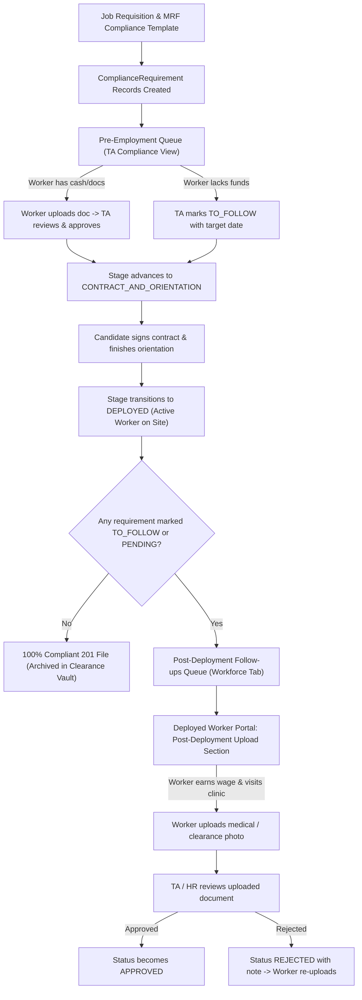

# Specification: Pre-Employment and Post-Deployment Compliance Lifecycle Tracking

- **Date:** 2026-10-02
- **Status:** Approved by User
- **Area:** Talent Acquisition / Workforce / Compliance Tracking / Applicant Portal
- **Approach:** Lifecycle-Based Separation (Single Requirements Architecture, Dynamic Operational Views)

---

## 1. Problem Statement & User Context

In high-volume recruitment in the Philippines, applicants often lack upfront funds for clinic fees, diagnostic laboratory exams, or clearance appointments (such as NBI Clearance and Fit-to-Work Medical Certificates). Under Philippine recruitment agency standards, employers deploy workers under a promissory undertaking. Workers begin on-site duties and earn wages, then submit required clearances after their first or second salary cutoff.

MEGS already permits setting a requirement status to `TO_FOLLOW`, which unlocks deployment. However, combining all compliance records into a single pre-employment table causes operational problems:

1. Recruiters managing candidates awaiting initial deployment share the same table with deployed workers who have been on client sites for weeks.
2. Talent Acquisition officers lose track of post-deployment target dates and overdue documents.
3. Deployed applicants see generic application screens rather than an explicit post-deployment document submission portal.

This feature introduces a clean lifecycle separation:
- **Pre-Employment Queue:** Tracks candidates preparing for deployment.
- **Post-Deployment Follow-ups Queue:** Tracks active, deployed workers with pending or to-follow requirements.
- **Post-Deployment Worker Submission View:** Guides deployed workers to upload pending documents from mobile devices or desktops.

---

## 2. Architecture & Lifecycle Data Flow

---

## 3. Recruiter & HR Workflow (Workforce Views)

### 3.1 Sub-Navigation Restructuring (`frontend/src/pages/ta/WorkforcePage.tsx`)
The current Workforce page contains three tabs:
1. `deployments` (Deployments)
2. `employees` (Employee Records 201)
3. `clearances` (Pre-employment Requirements)

We update the tabs on the Workforce page to present compliance in two clear operational views:
- **Deployments:** Active and scheduled site assignments.
- **Employee Records (201):** Active personnel records.
- **Pre-Employment Queue:** Candidates in pipeline stages (`COMPLIANCE`, `CONTRACT_AND_ORIENTATION`) preparing for deployment.
- **Post-Deployment Follow-ups:** Deployed personnel with incomplete 201 documentation or active `TO_FOLLOW` commitments.

### 3.2 Pre-Employment Queue (`CompliancePage.tsx` in Pre-Employment Mode)
- **Target Audience:** Recruiters clearing candidates for initial deployment.
- **Filter Scope:** Restricts to applications with status `COMPLIANCE` or `CONTRACT_AND_ORIENTATION`.
- **Primary Actions:**
  - Verify submitted files (Approve or Reject).
  - Mark missing items as `TO_FOLLOW` when the candidate requests deferral due to finances.
  - Set target completion date (defaulting to 30 days after hire or target start date).
  - Save promissory note in `reviewNotes`.
- **Deployment Qualification:** Once all mandatory items have status `APPROVED` or `TO_FOLLOW`, the candidate advances to contract signing and orientation without system blocks.

### 3.3 Post-Deployment Follow-ups Queue (New View Component: `PostDeploymentCompliancePage.tsx`)
- **Target Audience:** Talent Acquisition and HR Workforce compliance officers.
- **Filter Scope:** Restricts to applications with status `DEPLOYED` that have at least one requirement with status `TO_FOLLOW`, `PENDING`, or `SUBMITTED`.
- **Table Data Columns:**
  1. **Worker:** Candidate full name, email, employee number.
  2. **Assignment:** Job title, client name, work site location.
  3. **Deployment Date:** Date candidate began work, including duration on site (for example, "18 days on site").
  4. **Outstanding Requirements:** Badge indicators for incomplete items (for example, "Fit to Work Medical", "NBI Clearance").
  5. **Due Date & Urgency Status:**
     - Green: Target date more than 7 days away.
     - Amber: Target date within 7 days.
     - Red: Target date past due.
  6. **Review Action:** Opens Quick Review dialog to inspect new uploads or update the target date.

### 3.4 Employee 201 Clearance Vault (`EmployeeDetailPage.tsx`)
Update the Clearance Vault tab on the employee profile:
- Group requirements into two sections:
  1. **Verified Documents:** Items marked `APPROVED`.
  2. **Pending Follow-up Items:** Items marked `TO_FOLLOW`, `SUBMITTED`, or `PENDING`, displaying target dates and direct review buttons for HR staff.

---

## 4. Deployed Applicant Experience (`ApplicationDetailPage.tsx`)

### 4.1 Status Banner
When `application.status === "DEPLOYED"`, check for incomplete requirements:
- **Incomplete Requirements Present:**
  Display an informational banner:
  - Title: Deployed to work site
  - Description: You are actively deployed. Upload your remaining requirements once available.
  - Summary count: Shows remaining items count.
- **All Requirements Complete:**
  Display a completion banner:
  - Title: Deployed to work site
  - Description: All pre-employment and post-deployment requirements are verified. Your 201 file is complete.

### 4.2 Grouped Checklist Display
Divide the requirements checklist into two distinct card sections:
1. **Requirements to Follow (Action Required):**
   - Renders each pending or to-follow document.
   - Shows badge with target submission date (for example, "Submit on or before Oct 30, 2026").
   - Includes primary "Upload Document" button.
   - Allows direct photo capture from phone cameras or file upload from local storage.
2. **Approved Clearances:**
   - Shows all verified items with checkmark badges and "View" links.

---

## 5. Backend Logic & API Contract

### 5.1 Service Adjustments (`backend/src/services/ta/ta.compliance.service.ts`)
- The existing `isFullyCompliant` helper already treats `TO_FOLLOW` as compliant for stage advancement.
- Add endpoint or query parameter in `listApplications` or compliance controller to support stage scoping:
  - `scope=pre_employment`: Filters applications where status is in `["COMPLIANCE", "CONTRACT_AND_ORIENTATION"]`.
  - `scope=post_deployment`: Filters applications where status is `"DEPLOYED"` and at least one requirement has status in `["TO_FOLLOW", "PENDING", "SUBMITTED", "REJECTED"]`.

### 5.2 Follow-Up Target Date Updates
Ensure recruiters and HR staff can update the `toFollowExpectedAt` date when workers request extensions, logging an audit event under `COMPLIANCE_REQUIREMENT_REVIEWED`.

---

## 6. Error Handling & Edge Cases

1. **Target Date Expiration:**
   When `toFollowExpectedAt` passes without an upload, the system flags the row as overdue. It does not suspend the worker or restrict application access.
2. **Rejection of Uploaded Follow-Up:**
   If a worker uploads an invalid photo, HR marks it `REJECTED` with an explanatory note. The status changes to `REJECTED`, and the upload button re-enables for the worker.
3. **Redeployment:**
   When an active employee finishes a contract and moves to a new assignment, valid documents (such as government IDs and statutory numbers) persist on their 201 record. Only time-sensitive documents (such as medical clearances older than six months) require renewal.

---

## 7. Verification & Testing Plan

1. **Type Safety & Build:**
   Execute TypeScript compilation in both `frontend` and `backend` workspaces.
2. **Pipeline Stage Advancement Test:**
   Verify a candidate with one approved item and one `TO_FOLLOW` item advances to `CONTRACT_AND_ORIENTATION` and then `DEPLOYED` without errors.
3. **Queue Separation Test:**
   - Candidate in `COMPLIANCE` appears in the Pre-Employment queue.
   - Once deployed, the candidate moves out of the Pre-Employment queue and appears in the Post-Deployment Follow-ups queue if any document is `TO_FOLLOW`.
   - Once all documents become `APPROVED`, the candidate leaves the Post-Deployment Follow-ups queue.
4. **Applicant Upload Test:**
   Log in as an applicant whose application is `DEPLOYED` with a `TO_FOLLOW` requirement. Upload a document, confirm the status shifts to `SUBMITTED`, and confirm HR can approve it.
